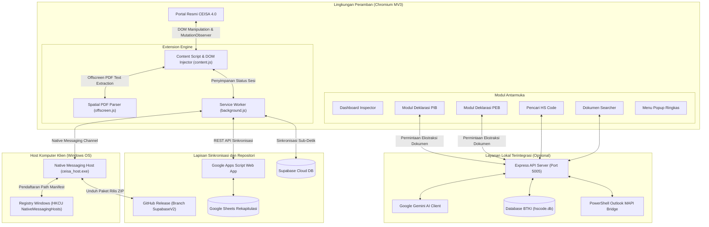

<div align="center">
  
  <h1>CEISA 4.0 AUTOMATION SUITE</h1>
  <p><strong>Enterprise Customs Automation Hub, Spatial Document Inspector & Distributed Operational Suite</strong><br/>
  <em>Infrastruktur Terintegrasi untuk Optimalisasi Alur Kerja Portal CEISA 4.0 Direktorat Jenderal Bea dan Cukai (DJBC)</em></p>

  <p>
    <a href="https://github.com/MrPainOi/Synthetic"></a>
    <a href="manifest.json"></a>
    <a href="launcher/"></a>
    <a href="backend-service/"></a>
    <a href="backend-service/"></a>
    <a href="sync.js"></a>
  </p>

  <p>
    <a href="#ringkasan-eksekutif">Ringkasan</a> &bull;
    <a href="#fitur-dan-modul-utama">Modul Sistem</a> &bull;
    <a href="#matriks-klasifikasi-dan-status">Matriks Status</a> &bull;
    <a href="#arsitektur-sistem">Arsitektur</a> &bull;
    <a href="#panduan-instalasi-dan-aktivasi">Instalasi</a> &bull;
    <a href="#mekanisme-pembaruan-sistem">Pembaruan</a> &bull;
    <a href="#struktur-repositori">Repositori</a> &bull;
    <a href="#keamanan-dan-privasi">Keamanan</a>
  </p>
</div>

<hr/>

## Ringkasan Eksekutif

> [!NOTE]
> CEISA 4.0 Automation Suite adalah solusi perangkat lunak mandiri yang dirancang untuk menghilangkan beban kerja manual, mempercepat verifikasi dokumen kepabeanan, serta meniadakan risiko kesalahan klasifikasi pelabuhan pada portal resmi CEISA 4.0.

Sistem ini menggabungkan ekstensi peramban berbasis **Chromium Manifest V3**, engine ekstraksi teks PDF dengan **rekonstruksi koordinat spasial** (offscreen), generator deklarasi pabean berbantuan **kecerdasan buatan (AI)**, basis data **BTKI HS Code lokal offline**, serta sistem sinkronisasi terdistribusi antar-workstation tanpa ketergantungan pada server pihak ketiga yang kompleks.

---

## Fitur dan Modul Utama

<table width="100%">
  <thead>
    <tr>
      <th width="50%" align="left">Modul & Kemampuan</th>
      <th width="50%" align="left">Deskripsi Teknis</th>
    </tr>
  </thead>
  <tbody>
    <tr>
      <td valign="top">
        <strong>DOM Observer & Smart Color Injection</strong><br/>
        <em>content.js &bull; sync.js</em>
      </td>
      <td valign="top">
        Memantau mutasi DOM pada tabel CEISA 4.0 secara real-time. Menginjeksi penanda visual baris sesuai jenis respon (SPPB, NPPB, Nota Pembetulan, Jalur Hijau/Kuning/Merah, SPJM, SPBL) serta mengklasifikasi pelabuhan muat/bongkar secara otomatis.
      </td>
    </tr>
    <tr>
      <td valign="top">
        <strong>Offscreen Spatial PDF Engine</strong><br/>
        <em>offscreen.js &bull; pdf.mjs</em>
      </td>
      <td valign="top">
        Mengekstraksi teks dokumen laporan JasperReports CEISA melalui lingkungan offscreen. Rekonstruksi baris dilakukan berdasarkan koordinat visual kartesius (sumbu Y-descending dan X-ascending) sehingga field lokasi dan pengangkut tidak tertukar pada format multi-kolom.
      </td>
    </tr>
    <tr>
      <td valign="top">
        <strong>AI-Powered Declaration Builder</strong><br/>
        <em>pib.html &bull; peb.html &bull; document_parser.js</em>
      </td>
      <td valign="top">
        Membaca dan memetakan dokumen non-standar (Commercial Invoice, Packing List, B/L, AWB) menjadi draf pabean resmi menggunakan Google Gemini API. Mendukung validasi field skema CEISA 4.0 serta ekspor/impor draf JSON.
      </td>
    </tr>
    <tr>
      <td valign="top">
        <strong>BTKI & HS Code Offline Database</strong><br/>
        <em>hscode.html &bull; hscode_service.js</em>
      </td>
      <td valign="top">
        Pencarian instan lebih dari 8.000 pos tarif Buku Tarif Kepabeanan Indonesia (BTKI) dan klasifikasi World Customs Organization (WCO) berbasis SQLite 3 WAL. Dilengkapi asistensi AI untuk klasifikasi deskripsi teknis komoditas.
      </td>
    </tr>
    <tr>
      <td valign="top">
        <strong>Dokumen Searcher & Outlook MAPI</strong><br/>
        <em>doc_searcher.html &bull; outlook_searcher.ps1</em>
      </td>
      <td valign="top">
        Memindai pesan masuk dan lampiran Microsoft Outlook Desktop melalui integrasi PowerShell MAPI. Berkas pendukung diidentifikasi berdasarkan nomor pendaftaran dokumen lalu dikompresi ke dalam arsip ZIP siap unggah.
      </td>
    </tr>
    <tr>
      <td valign="top">
        <strong>Zero-Dependency Native Updater</strong><br/>
        <em>launcher/ceisa_host.exe &bull; AKTIFKAN_UPDATE_DI_CHROME.bat</em>
      </td>
      <td valign="top">
        Host Native Messaging berbasis C# .NET standar Windows. Memungkinkan seluruh komputer staf memperbarui ekstensi langsung dari rilis GitHub hanya dengan menekan satu tombol pada antarmuka tanpa membutuhkan instalasi Git atau Node.js.
      </td>
    </tr>
  </tbody>
</table>

---

## Matriks Klasifikasi dan Status

Ekstensi secara deterministik memvalidasi isi respon dokumen pabean dan menerapkan diferensiasi status operasional sebagai berikut:

| Jenis Dokumen | Pelabuhan / Lokasi Teridentifikasi | Status Warna | Aksi Operasional |
| :--- | :--- | :--- | :--- |
| **SPPB** | `IDBTU - BATU AMPAR` | <code>Merah (Red)</code> | Pengeluaran barang via Pelabuhan Batu Ampar |
| **SPPB** | `SEWU` / `IDKSP - SEKUPANG` | <code>Oranye (Orange)</code> | Pengeluaran barang via Pelabuhan Sekupang / Sewu |
| **NPPB** | `SEWU` | <code>Hijau (Green)</code> | Persetujuan ekspor via Sewu |
| **NPPB** | `IDBTU - BATU AMPAR` | <code>Ungu (Purple)</code> | Persetujuan ekspor via Batu Ampar |
| **NPPB** | `IDKSP - SEKUPANG` | <code>Biru (Blue)</code> | Persetujuan ekspor via Sekupang |
| **PIB / Respon** | Jalur Hijau | <code>Hijau Muda</code> | Dokumen selesai tanpa pemeriksaan fisik |
| **PIB / Respon** | Jalur Kuning | <code>Kuning</code> | Pemeriksaan dokumen lanjutan |
| **PIB / Respon** | Jalur Merah / SPJM | <code>Merah Solid</code> | Wajib pemeriksaan fisik barang |

> [!IMPORTANT]
> Klasifikasi pelabuhan di atas beroperasi secara murni berbasis aturan (*100% rule-based*) melalui ekstraksi teks pada kolom *LOKASI BARANG* atau *PELABUHAN MUAT*, tanpa menggunakan daftar nama perusahaan yang di-hardcode.

---

## Arsitektur Sistem



---

## Panduan Instalasi dan Aktivasi

### 1. Pemasangan Ekstensi Browser
1. Buka peramban **Google Chrome** atau **Microsoft Edge**.
2. Buka tab baru dan masukkan alamat:
   - Chrome: `chrome://extensions`
   - Edge: `edge://extensions`
3. Aktifkan opsi **Developer mode** (Mode pengembang) pada sudut kanan atas.
4. Klik tombol **Load unpacked** (Muat yang belum dibongkar).
5. Arahkan dan pilih direktori root repositori ini (`Synthetic`).
6. Ekstensi **CEISA 4.0 Automation** akan terpasang dan siap digunakan.

### 2. Registrasi Native Messaging Host (Pembaruan Otomatis Klien)
Agar tombol **"Perbarui Sekarang"** di antarmuka ekstensi dapat bekerja otomatis tanpa instalasi Git atau Node.js:
1. Buka direktori repositori di Windows Explorer.
2. Klik ganda berkas `AKTIFKAN_UPDATE_DI_CHROME.bat`.
3. Skrip akan memverifikasi path absolut dan menambahkan manifest host ke Registry Windows:
   - `HKCU\Software\Google\Chrome\NativeMessagingHosts\com.ceisa.server_launcher`
   - `HKCU\Software\Microsoft\Edge\NativeMessagingHosts\com.ceisa.server_launcher`

### 3. Konfigurasi Sinkronisasi Google Sheets
1. Buat salinan berkas template konfigurasi:
   ```cmd
   copy config.example.js config.js
   ```
2. Tetapkan endpoint Google Apps Script pada berkas `config.js`:
   ```javascript
   const CEISA_CONFIG = {
       SYNC_PROVIDER: "google_sheets",
       GOOGLE_SCRIPT_URL: "https://script.google.com/macros/s/AKfyc.../exec"
   };
   ```
3. Petunjuk deployment Google Apps Script:
   - Buat spreadsheet baru pada Google Drive.
   - Buka menu **Ekstensi** &gt; **Apps Script**.
   - Timpa seluruh kode editor dengan isi berkas `google-apps-script/Code.gs`.
   - Klik tombol **Deploy** &gt; **New deployment** &gt; Pilih jenis **Web app**.
   - Konfigurasikan *Execute as: Me* dan *Who has access: Anyone*.
   - Salin URL Web App yang terbentuk ke properti `GOOGLE_SCRIPT_URL` di `config.js`.

### 4. Konfigurasi Layanan Backend (Lokal)
> [!TIP]
> Tahap ini opsional, hanya diperlukan pada workstation yang menjalankan modul parser AI, pencarian email Outlook, atau basis data offline HS Code.

1. Pastikan runtime **Node.js (v18+)** terpasang pada workstation server/admin.
2. Jalankan berkas `SETUP_PC.bat` untuk mengunduh dependensi npm dan menginisialisasi basis data pos tarif.
3. Buat berkas `backend-service/.env`:
   ```env
   PORT=5005
   GEMINI_API_KEY=KunciApiGoogleGeminiAnda
   ```
4. Jalankan server melalui berkas `START_SERVER.bat`.

---

## Mekanisme Pembaruan Sistem

<table width="100%">
  <thead>
    <tr>
      <th width="50%" align="left">Sisi Klien (Workstation Operasional)</th>
      <th width="50%" align="left">Sisi Pengembang (Publishing Workflow)</th>
    </tr>
  </thead>
  <tbody>
    <tr>
      <td valign="top">
        <ol>
          <li>Buka Dashboard Ekstensi pada peramban.</li>
          <li>Arahkan ke tab <strong>Update & Sistem</strong>.</li>
          <li>Klik tombol <strong>Perbarui Sekarang</strong>.</li>
          <li>Sistem akan mengunduh paket rilis terbaru secara atomik dan memuat ulang ekstensi tanpa jeda operasional.</li>
        </ol>
        <p><em>Alternatif: Jalankan berkas <code>UPDATE.bat</code> langsung dari folder instalasi.</em></p>
      </td>
      <td valign="top">
        <ol>
          <li>Lakukan perbaikan atau penambahan fitur pada kode sumber.</li>
          <li>Verifikasi konsistensi versi pada <code>manifest.json</code>, <code>version.json</code>, dan <code>dashboard.html</code>.</li>
          <li>Bila <code>launcher/ceisa_host.cs</code> dimodifikasi, lakukan kompilasi biner:
            <pre><code>C:\Windows\Microsoft.NET\Framework64\v4.0.30319\csc.exe /r:System.IO.Compression.FileSystem.dll /out:launcher\ceisa_host.exe /target:exe launcher\ceisa_host.cs</code></pre>
          </li>
          <li>Jalankan <code>PUSH_UPDATE.bat</code> untuk melakukan push commit ke branch <code>SupabaseV2</code> dan menyiarkan sinyal update ke Google Sheets.</li>
        </ol>
      </td>
    </tr>
  </tbody>
</table>

---

## Struktur Repositori

<details>
<summary><strong>Klik untuk menampilkan struktur direktori lengkap</strong></summary>

```text
├── .agents/                          # Aturan dan konfigurasi asisten pengembangan
├── backend-service/                  # Layanan backend Node.js (Port 5005)
│   ├── temp/                         # Direktori berkas sementara dan cache basis data
│   │   └── hscode.db                 # Basis data SQLite pos tarif BTKI WCO
│   ├── doc_searcher_service.js       # Layanan integrasi pencarian lampiran dokumen
│   ├── document_parser.js            # Parser dokumen komersial berbasis Google Gemini
│   ├── hscode_service.js             # Kueri pos tarif SQLite dengan dukungan AI
│   ├── import_hscode.js              # Utilitas importir data tarif ke SQLite
│   ├── outlook_searcher.ps1          # Skrip interop MAPI Microsoft Outlook
│   ├── package.json                  # Dependensi Express, Better-SQLite3, GenAI
│   └── server.js                     # Server utama API backend lokal
├── google-apps-script/
│   └── Code.gs                       # REST API Google Sheets & formatting engine
├── launcher/
│   ├── ceisa_host.cs                 # Kode sumber C# Native Messaging Host
│   ├── ceisa_host.exe                # Biner terkompilasi Native Messaging Host
│   ├── com.ceisa.server_launcher.json # Manifest Native Messaging Chrome/Edge
│   └── launcher.bat                  # Script perantara eksekusi launcher
├── drafts/                           # Direktori penyimpanan draf PIB/PEB lokal (.json)
├── icons/                            # Aset visual ekstensi peramban
├── AKTIFKAN_UPDATE_DI_CHROME.bat     # Pendaftaran Registry host Native Messaging
├── PUSH_UPDATE.bat                   # Publikasi rilis pengembang ke GitHub & Sheets
├── SETUP_PC.bat                      # Inisialisasi dependensi & database pada PC baru
├── START_SERVER.bat                  # Eksekusi server backend di latar belakang
├── UPDATE.bat                        # Skrip pembaruan mandiri workstation klien
├── background.js                     # Background Service Worker Chrome MV3
├── config.example.js                 # Template konfigurasi sinkronisasi data
├── content.js                        # Injeksi DOM, observasi status, dan pewarnaan tabel
├── dashboard.html / .js / .css       # Antarmuka utama pemantauan dan kontrol sistem
├── doc_searcher.html / .js           # Antarmuka penelusuran lampiran Outlook
├── hscode.html / .js                 # Antarmuka penelusuran pos tarif BTKI
├── manifest.json                     # Chrome Extension Manifest V3
├── offscreen.html / .js              # Worker ekstraksi PDF berbasis koordinat spasial
├── peb.html / peb_dashboard.js       # Modul pembangun deklarasi ekspor (PEB)
├── pib.html / pib_dashboard.js       # Modul pembangun deklarasi impor (PIB)
├── popup.html / popup.js             # Menu popup ringkas pada toolbar browser
├── publish_update.js                 # Skrip otomasi rilis versi pengembang
├── sync.js                           # Pustaka komunikasi data terdistribusi
├── version.json                      # Metadata versi aktif dan commit hash
└── wifi-share.js                     # Modul pendistribusian dashboard via jaringan lokal
```
</details>

---

## Keamanan dan Privasi

1. **Pemrosesan Data Lokal (Local-First Architecture)**: Seluruh pemindaian berkas PDF respon kepabeanan dieksekusi secara lokal di dalam peramban klien menggunakan engine offscreen. Tidak ada berkas respon pabean yang dikirimkan ke server eksternal.
2. **Pencegahan Kebocoran Kredensial**: Berkas yang memuat kunci API dan parameter privat (`.env`, `config.js`, direktori `drafts/`, dan log sistem) terdaftar secara ketat di `.gitignore` dan tidak akan terunggah ke repositori.
3. **Integritas Format Spreadsheet**: Komunikasi sinkronisasi ke Google Spreadsheet hanya mentransfer data ringkas terformat tanpa menyematkan struktur data mentah yang dapat membebani kapasitas dokumen.

---

<div align="center">
  <sub>Sistem Otomasi CEISA 4.0 &bull; Dikelola dan dipelihara untuk keandalan operasional kepabeanan standar industri.</sub>
</div>
